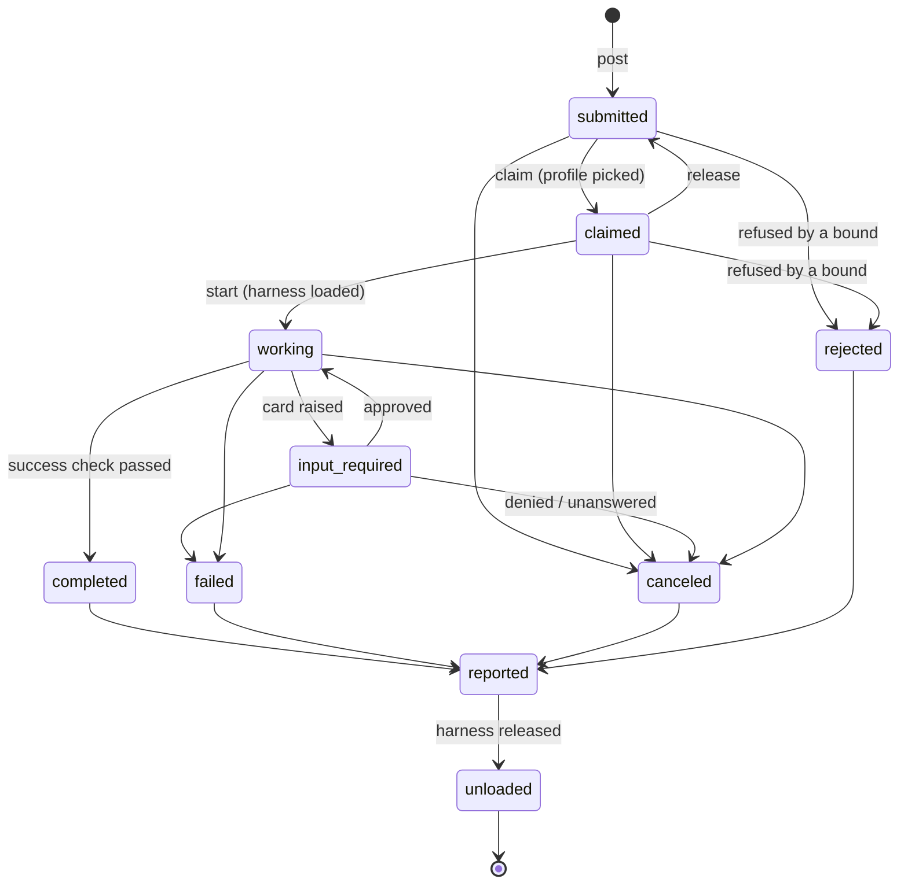

# 5. The task lifecycle

A task's state is the fold of its records: the `to` of its last `stew.task.state` record, or `submitted`
after `stew.task.posted` alone. The states and their allowed transitions are:

(Mermaid cannot draw a dash in a state name, so the diagram writes `input_required`. The state is
`input-required`.)

## Requirements

1. A runtime MUST NOT append a transition that is not in the diagram. A validator MUST reject a ledger that
   contains one (`tools/validate.py` does).
2. `completed`, `failed`, `canceled` and `rejected` are the **outcomes**. A task has exactly one outcome, and
   the outcome is never changed. `reported` and `unloaded` are **closing phases**: the runtime's own
   bookkeeping after the outcome.
3. `completed` MUST be appended only when the profile's `success` check passed on the run's record.
4. `unloaded` MUST be appended only after the harness has released the accelerator (spec/orchestration.md).
   A task that never loaded a harness still passes through `unloaded`, which then records that nothing was
   held.

## Mapping to A2A

STEW reuses A2A's task-state names wherever they mean the same thing. A2A 1.0.0 writes them in its ProtoJSON
form (`TASK_STATE_*`); A2A 0.3 and earlier wrote the lowercase form that STEW uses.

| STEW state | A2A 1.0.0 `TaskState` | A2A ≤ 0.3 |
|---|---|---|
| `submitted` | `TASK_STATE_SUBMITTED` | `submitted` |
| `claimed` | `TASK_STATE_SUBMITTED` (STEW-only: picked, not yet running) | `submitted` |
| `working` | `TASK_STATE_WORKING` | `working` |
| `input-required` | `TASK_STATE_INPUT_REQUIRED` | `input-required` |
| `completed` | `TASK_STATE_COMPLETED` | `completed` |
| `failed` | `TASK_STATE_FAILED` | `failed` |
| `canceled` | `TASK_STATE_CANCELED` | `canceled` |
| `rejected` | `TASK_STATE_REJECTED` | `rejected` |
| `reported`, `unloaded` | the outcome's state (STEW-only closing phases) | the outcome's state |

A2A's `TASK_STATE_AUTH_REQUIRED` has no STEW state. A STEW runtime never asks a model to obtain
credentials (spec/security.md), so a task that would need them is `rejected`.
